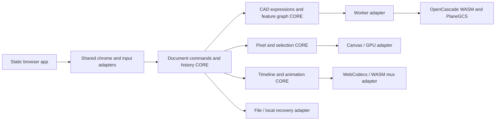

# Architecture

One static browser build, three workspace sessions, one XP-inspired web application shell. TypeScript with strict checking and native DOM/CSS keeps interaction boundaries explicit; Vite produces static assets. Framework selection is an implementation decision, not a new user requirement. No runtime server computation.

## Boundaries

Geometry recipes, units, expressions, dependency ordering, selection semantics, pixel mathematics, timeline arithmetic and interpolation are CORE: deterministic, no DOM, I/O, clock or global state. Kernel execution/loading, Canvas/WebGL, codec I/O, file reads, browser storage, workers and UI bindings are SHELL. WASM adapters translate a typed request; feature policy remains in CORE. The proven solver and B-rep kernel are never reimplemented.

Assemblies wire already GREEN bricks and do no business logic. Each brick has one public entry point (at most three public symbols), at most five inputs or one named request, at most three brick dependencies, and fewer than 300 implementation lines. Small typed callback ports preserve direction across browser boundaries, not dependency concealment. The map lists actual collaborating bricks; an assembly is not presented as a brick.

## State and transactions

Each workspace owns a versioned document and a 100-step minimum history. Preview transactions are transient until OK/Enter; Esc/Cancel returns to the unchanged committed state. Pointer strokes and drags become one undoable transaction, not one step per event. UI navigation (zoom, pan, active tool) is session state; edits to document content and editable settings are undoable. Clipboard and destructive document operations use the active workspace's command policy.

A command returns immutable state plus typed effects; the shell executes effects and returns results. A failed worker job never commits an invalid body or replaces the last valid result without a visible failure marker. Job sequence numbers discard stale results after undo/edit. Closing/replacing a project prompts about unsaved work. Failed saves retain the dirty state. History storage uses tile/feature/clip deltas where full snapshots would exceed memory budgets.

## CAD

Serialized source-of-truth: units, named expressions, sketches, constraints, reference geometry, ordered features, suppression and rollback cursor. Rebuild uses topological dependencies and a bounded cached prefix. Geometric references use semantic selectors plus validated topology signatures; face/edge identifiers alone are insufficient after regeneration. Lost or ambiguous references fail explicitly. Tessellated display meshes are derived and cannot become the solid source of truth. Kernel tolerance, unit scaling and export tolerance are versioned decisions.

The worker owns WASM lifetimes and B-rep handles. Only transferable display buffers, stable logical references, diagnostics and requested export bytes cross the worker boundary. Selection uses GPU/ray IDs linked to validated kernel topology. Model operations must be cancellable or a hung worker replaced with explicit recovery. No CAD UI action is a fake mesh-only substitute for a solid operation.

## Image

Sparse tiles separate layer pixels, masks and composited display. Selection coverage is a numeric mask; operations share clipping semantics. Text remains a structured layer until explicit rasterization. Fixed rounding, alpha and color-space rules are documented and tested independently of platform Canvas so golden pixels are exact. Pressure and pointer samples enter as values; Canvas is an output adapter. Work is batched per frame; costly filters run off the main thread.

## Video

Integer frame/timebase coordinates avoid drift; rational playback rates and audio sample times are mapped explicitly. File handles or reselected File objects back range reads. Projects preserve source identities and reconnect missing files visibly; browsers may require renewed permission after reload. Decode queues and frame lifetimes are bounded. Audio is the playback clock. Preview first reduces render scale under load; it never silently alters export settings. Native codec capability probes precede export. The muxer owns containers; timeline CORE owns duration, transitions and parameter samples. Cancel releases codecs, frames and temporary outputs.

## Persistence, offline and delivery

Workspace format envelopes use distinct format tags and versions. Live history keeps immutable domain values (including typed arrays/maps/bigint) rather than JSON copies. Per-workspace codecs convert source state into Json metadata and named binary assets. Shared S15 frames those into a documented segmented binary container, checks lengths/CRC, and feeds the same file/recovery adapters; S03 validates only common Json metadata. Unknown future versions and malformed or oversized inputs are rejected before replacement. Browser recovery uses local persistent storage (small journal in localStorage; bulk data in IndexedDB/OPFS), with atomic generations and visible quota errors. Save uses File System Access where available; fallback is download and explicit file selection. Video reference projects do not embed original media by default.

Service-worker installation caches a complete hashed static manifest before activation, including kernels, codecs, fonts and icons. No third-party runtime requests. An incomplete update does not discard the previous working cache. Web and loopback servers apply COOP/COEP and appropriate resource policies. Every shipped asset must pass the current Pages per-file limit independently.

The local package follows M1a: native launchers locate adjacent mutable `app/`, bootstrap a pinned managed runtime and serve only static assets on loopback. No document API or state-changing application endpoints. Launch must open the browser UI; supported-platform claims require actual launcher and GUI smoke tests.
